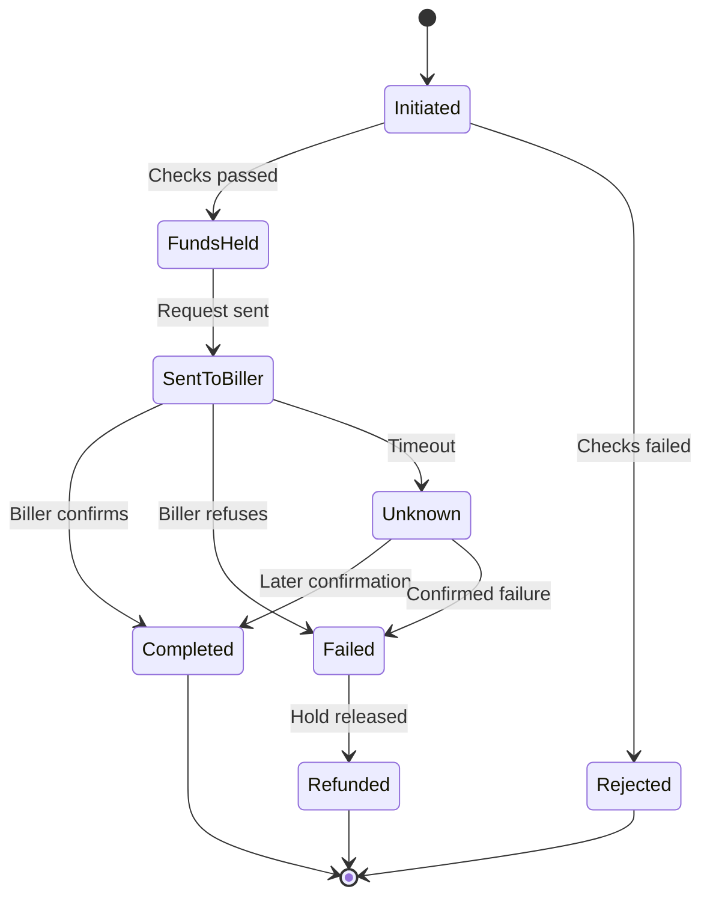

# PayLink — Digital Wallet & Bill Payment Platform

<p align="center">
  A secure and extensible backend for digital wallets and bill payments in Egypt.
</p>

<p align="center">
  
  
  
  
  
  
</p>

---

## Overview

**PayLink** is a digital wallet and bill-payment backend designed to simplify how customers in Egypt pay their everyday bills.

The platform enables customers to pay electricity, water, mobile, and internet bills directly from their digital wallets. It is designed around financial correctness, reliability, and extensibility, with particular attention to preventing duplicate charges, handling payment failures, and maintaining accurate financial records.

PayLink also supports agent-assisted payments, service fees, commissions, and reconciliation with billers.

> **Project status:** Under active development. The current repository provides the initial application and infrastructure foundation. Core business modules and integrations are part of the planned implementation.

## Key Capabilities

The target system is designed to support:

- **Digital Wallets** — Manage customer balances and wallet transactions.
- **Bill Payments** — Pay electricity, water, mobile, and internet bills.
- **Biller Integration** — Integrate with different billers through isolated adapters.
- **Payment Lifecycle Management** — Track payments from initiation to completion, failure, or refund.
- **Transaction Safety** — Prevent duplicate payments and protect wallet balances during concurrent requests.
- **Fees & Commissions** — Calculate service fees and agent commissions according to configurable business rules.
- **Fraud Prevention** — Apply transaction limits and velocity checks.
- **Notifications** — Notify customers about payment results.
- **Reconciliation** — Compare internal payment records with biller settlement files.

## Technology Stack

| Technology | Purpose |
|---|---|
| Java 21 | Primary programming language |
| Spring Boot 3.5.7 | Backend application framework |
| Spring Data JPA | Persistence and database access |
| Microsoft SQL Server | Relational database |
| Flyway | Database schema migrations |
| Maven | Dependency and build management |
| Docker & Docker Compose | Containerization and local environment |
| GitHub Actions | Continuous integration |
| JUnit / Spring Boot Test | Automated testing |

## Architecture

PayLink follows a **Modular Monolith** architectural direction. The goal is to keep business capabilities separated into well-defined modules while maintaining a single deployable backend application.

The planned module boundaries include:

| Module | Responsibility |
|---|---|
| Accounts & Wallet | Customer accounts, wallet balances, holds, and ledger entries |
| Biller Catalog | Biller information, services, and required customer inputs |
| Payment Processing | Payment orchestration, lifecycle, and idempotency |
| Biller Integration | Communication with external and mock billers |
| Fees & Commissions | Service fee and agent commission calculations |
| Notifications | SMS, email, and push notification handling |
| Fraud Prevention | Transaction limits and suspicious activity checks |
| Reconciliation | Settlement processing and payment discrepancy detection |

The architecture is intended to make future changes easier. For example, adding a new biller should require a new integration and configuration rather than changes across existing business modules.

## Payment Lifecycle

Every payment follows a controlled lifecycle to ensure that money is not incorrectly charged or refunded.



**Important financial principle:** A payment in the `Unknown` state must not be refunded automatically. The system must first establish whether the biller actually received the payment.

## Supported Biller Integrations

The project brief defines four biller integration scenarios:

| Biller | Service | Integration Type |
|---|---|---|
| ElectroCo | Electricity | REST / JSON |
| AquaCo | Water | SOAP-style XML over HTTP |
| TopUpNet | Mobile Top-up | REST / JSON with asynchronous callback |
| NetCo | Internet | Daily batch CSV |

These different integration styles are intended to be handled behind a common biller integration boundary.

## Financial & Reliability Principles

PayLink is designed with the following rules in mind:

- **Idempotency:** Repeated payment requests must not result in duplicate charges.
- **Exact Money Handling:** Use `BigDecimal` for monetary values; never use floating-point types for financial calculations.
- **Wallet Consistency:** Concurrent transactions must never cause a wallet balance to become negative.
- **Auditability:** Financial movements must be traceable.
- **Failure Handling:** A biller outage should not prevent payments to other billers.
- **Safe Refunds:** Funds should only be released when the payment outcome is known.
- **Extensibility:** New billers should be added without modifying unrelated business modules.

## Getting Started

### Prerequisites

Make sure you have the following installed:

- [Git](https://git-scm.com/)
- [Docker Desktop](https://www.docker.com/products/docker-desktop/) or Docker Engine with Docker Compose
- Java 21 and Maven (only if you want to build or run the application outside Docker)

### 1. Clone the Repository

```bash
git clone https://github.com/MohamedTech98/PayLink.git
cd PayLink
```

### 2. Configure Environment Variables

Create a `.env` file from the provided example:

```bash
cp .env.example .env
```

Set a strong local SQL Server password in `.env`:

```env
DB_SA_PASSWORD=Your_Strong_Local_Password
```

Make sure the password satisfies SQL Server password requirements. Never commit your `.env` file or credentials.

### 3. Start the Application

Build and start the application and database:

```bash
docker compose up --build
```

Docker Compose starts the SQL Server database and the Spring Boot application. The application waits for the database health check before starting.

### 4. Verify the Application

Once the containers are running, check:

| Resource | URL |
|---|---|
| Application | http://localhost:8080 |
| Health Check | http://localhost:8080/actuator/health |

To inspect running containers:

```bash
docker compose ps
```

To view application logs:

```bash
docker compose logs -f app
```

### 5. Stop the Application

```bash
docker compose down
```

To remove the containers and the persisted SQL Server data volume:

```bash
docker compose down -v
```

> **Warning:** The `-v` option permanently deletes the database data stored in the Docker volume.

## Running Tests

To run the Maven verification lifecycle locally, make sure Java 21 and Maven are installed:

```bash
mvn clean verify
```

The repository also includes a GitHub Actions workflow that runs the build and test verification process on pushes and pull requests targeting `main`.

## Project Structure

```text
PayLink/
│
├── .github/
│   └── workflows/
│       └── ci.yml
│
├── docs/
│   ├── adr/
│   ├── design/
│   ├── testing/
│   ├── Requirements-Pack.md
│   └── prompt-log.md
│
├── src/
│   ├── main/
│   │   ├── java/
│   │   │   └── com/paylink/
│   │   └── resources/
│   │       └── db/migration/
│   │
│   └── test/
│       └── java/
│           └── com/paylink/
│
├── .env.example
├── .gitignore
├── Dockerfile
├── compose.yaml
└── pom.xml
```

*The structure will evolve as the business modules and integrations are implemented.*

## Development Workflow

The project uses a pull-request-based workflow to keep changes organized and reviewed.

1. Create a feature branch from `main`.
2. Implement the change and add relevant tests.
3. Run the verification process locally.
4. Open a pull request targeting `main`.
5. Review the changes and ensure the CI checks pass.
6. Merge only after the required review and checks are complete.

## Project Documentation

Additional project documentation is maintained in the `docs/` directory:

- **Requirements Pack** — Functional requirements, user stories, acceptance criteria, business rules, and non-functional requirements.
- **Design Documentation** — System diagrams and architectural design.
- **Architecture Decision Records (ADRs)** — Important architectural decisions and their rationale.
- **Prompt Log** — AI-assisted development interactions and refinements.
- **Testing Documentation** — Test strategy and related evidence.

## Project Goals

The project aims to demonstrate practical software engineering skills, including:

- Requirements engineering and analysis.
- Modular software architecture and design patterns.
- Test-driven development and automated testing.
- Secure and consistent financial transaction handling.
- Containerized development environments.
- Continuous integration and collaborative Git workflows.
- AI-assisted software development with human review.

## Contributors

Developed as a collaborative university year-work project.

<!-- Add team members and their GitHub profiles here. -->

---

<p align="center">
  <strong>PayLink</strong><br/>
  Making everyday bill payments simpler, safer, and more reliable.
</p>
